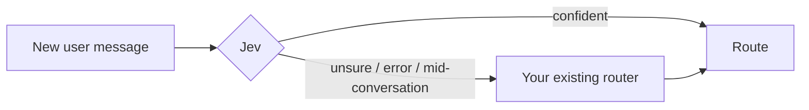

# langgraph-jev-router

**Keep your LangGraph router. Let Jev take the decisions it's sure about.**

[Jev](https://docs.typesafe.ai) is TypeSafe AI's decision model: it answers "which of these options?"
with calibrated probabilities instead of generated text, much faster and cheaper than an LLM call.
This package puts Jev in front of the routing you already have:

- Jev is **confident** → it decides, and your LLM router is never called.
- Jev is **unsure, unavailable, or out of its depth** → your router runs exactly as it does today.

Your existing router becomes the safety net, so adopting Jev can't make routing worse than it is now,
and nothing in your graph breaks if Jev has a bad day.



## The 60-second version

```python
from typing import Literal
from langgraph_jev_router import jev_first

@jev_first                                                  # <- the only new line
def route_ticket(state) -> Literal["billing", "tech", "account"]:
    ...                                                     # your existing LLM router, untouched
```

```bash
export TYPESAFE_API_KEY=...        # that's it
```

Optional but recommended: one more line lets Jev read your node docstrings as route descriptions,
which makes its decisions more accurate.

```python
from langgraph_jev_router import attach_routes
graph = attach_routes(builder).compile()
```

## Try it now (no API key needed)

```bash
cd langgraph-jev-router
python -m venv .venv
source .venv/bin/activate              # Windows: .venv\Scripts\activate
pip install -e ".[dev]"

pytest                                  # 59 tests, all offline
python examples/01_quickstart.py        # decorator on a conditional edge
python examples/02_shadow_then_live.py  # the recommended rollout, end to end
python examples/03_command_node.py      # supervisor node returning Command(goto=...)
python examples/04_prebuilt_supervisor.py  # prebuilt langgraph-supervisor, code you can't edit
```

Without a key the examples use `FakeJev`, a deterministic keyword-based stand-in, and say so. With
`TYPESAFE_API_KEY` set, the same scripts call real Jev. Verify your key, network and model first:

```bash
jev-router check
```

## Which integration fits your graph?

| Your routing looks like | Use | Example |
|---|---|---|
| A conditional-edge function returning a route name | `@jev_first` | `01_quickstart.py` |
| A node returning `Command(goto=...)` | `@jev_first` (detected from `-> Command[Literal[...]]`) | `03_command_node.py` |
| Code you can't or don't want to edit: prebuilt `create_supervisor`, a compiled subgraph, handoffs via LLM tool calls | `install_shortcut(builder, before="supervisor")` | `04_prebuilt_supervisor.py` |
| LangChain `create_agent` middleware (model routing, tool gating) | Not this package: use `langchain-typesafe`'s `ModelRouterMiddleware` / `AutoModeMiddleware` | |

`install_shortcut` adds one node in front of your supervisor. When Jev is confident it goes straight to
the chosen agent and the supervisor's routing call is skipped; otherwise it hands over to the supervisor
unchanged. Only the entry edge is rewired, so "what next / are we done?" decisions after an agent replies
stay with your supervisor.

**Not supported yet:** routers that fan out (`Send`, returning a list), multi-select routing, and
routers whose destinations can't be discovered and aren't given via `routes=`.

## Roll out safely: shadow → report → live

1. **Shadow.** Your router keeps deciding everything; Jev runs alongside and is only compared. It runs
   concurrently, so it adds almost no latency.
   ```bash
   export JEV_ROUTER_SHADOW=1
   export JEV_ROUTER_LOG=jev_decisions.jsonl
   ```
2. **Report.** After a few hundred decisions:
   ```bash
   jev-router report jev_decisions.jsonl --llm-cost-per-call 0.002
   ```
   ```
   SHADOW 412 decisions compared (your router decided; Jev only observed)
     Threshold | Jev would decide | Agrees with your router
        0.60  |   91.0% (n=375 ) |   93.9%
        0.70  |   84.2% (n=347 ) |   96.5%  <- recommended
        0.80  |   70.1% (n=289 ) |   98.6%
     Use threshold 0.70: Jev would decide 84% of routing calls and agree with your router 96.5% ...
     Most common disagreements (fix these descriptions first):
         Jev said 'tech', your router said 'billing': 7x
   ```
   *(Illustrative numbers.)* Agreement is measured against your current router, not ground truth.
   Where they disagree, read a few examples: sometimes your router is the one that's wrong.
3. **Live.** Unset `JEV_ROUTER_SHADOW` and set the threshold:
   `export JEV_ROUTER_THRESHOLD=0.7` (or `configure(threshold=0.7)`). The live report shows the
   LLM calls avoided, latency, and estimated cost.

In code, every router has its own report: `print(route_ticket.jev.report())`.

## Safety defaults

| Situation | What happens |
|---|---|
| Jev confident (≥ threshold, default 0.7) | Jev's route is used; your router isn't called |
| Jev below threshold | Your router decides |
| No API key, network error, timeout (5 s total budget), 5xx | Your router decides; one warning is logged |
| Jev answers with something that isn't a route | Your router decides |
| An agent or tool spoke last (graph is looping back) | Your router decides. This stops Jev re-sending the same request to the same agent forever. Override with `state_from=` |
| Route to `END` | Never chosen by Jev unless `include_end=True` |
| Same input seen again | Cached answer, no second Jev call |
| `JEV_ROUTER_DISABLED=1` | Jev fully off, everywhere, no code change |
| `JEV_ROUTER_SHADOW=1` | Jev only observes, everywhere, even if code says otherwise |

## Configuration (all optional)

| `@jev_first(...)` option | Default | Purpose |
|---|---|---|
| `routes` | discovered | Names, or `{name: description}`. Overrides discovery |
| `threshold` | `0.7` | Minimum Jev confidence to act on |
| `shadow` | `False` | Only measure; your router always decides |
| `state_from` | newest user message | `state -> str \| dict \| None`: what Jev sees |
| `question` | generic routing question | What Jev is asked; reference fields in backticks, e.g. `` `request` `` |
| `include_end` | `False` | Allow Jev to choose `END` |
| `on_jev` | `None` | For Command nodes: `(state, decision) -> update` when Jev decides |
| `model` | `jev-1.13.0` | Pinned Jev version (an alias like `jev-latest` can shift your thresholds) |
| `backend` | real Jev | `FakeJev(...)` for tests |

The same options work globally via `configure(...)`. Environment variables: `TYPESAFE_API_KEY`,
`TYPESAFE_DEFAULT_MODEL`, `JEV_ROUTER_THRESHOLD`, `JEV_ROUTER_SHADOW`, `JEV_ROUTER_DISABLED`,
`JEV_ROUTER_LOG`, `JEV_ROUTER_LOG_INPUTS`.

Precedence: decorator options, then `configure()`, then environment, then defaults, except the
two safety switches (`DISABLED`, `SHADOW`), which always win.

## Where route descriptions come from

Jev chooses better when each route has a one-line description. In order of priority:

1. `routes={"billing": "Charges, refunds, invoices"}` on the decorator or `install_shortcut`
2. The destination node's docstring (first paragraph), via `attach_routes(builder)`
3. The route name alone (works, less accurate; `attach_routes` logs which routes lack descriptions)

## Privacy and data

- **Sent to TypeSafe's API:** the newest user message (or whatever your `state_from` returns), plus
  route names and descriptions. Check your organization's data-handling policy before enabling this on
  production traffic.
- **Kept locally:** each decision's route, confidence, timings and a short hash of the input. Message text
  is stored only if you set `log_inputs=True`.
- **No telemetry.** Nothing else leaves your process.

## Testing your own graphs

```python
from langgraph_jev_router import FakeJev, configure

configure(backend=FakeJev({"billing": ["refund", "invoice"], "tech": ["error", "crash"]}))
# or exact control:
configure(backend=FakeJev(decide=lambda text, routes: ("billing", 0.95)))
```

`FakeJev` is only ever used when you pass it. The library never silently substitutes it.

## Status and known limits

- **Tested:** 59 tests covering sync and async graphs, conditional edges, Command nodes, a hand-built
  supervisor, and the real prebuilt `create_supervisor`. The real `typesafe-sdk` 0.7.2 client is exercised
  end to end against a local server that speaks Jev's wire format (request body, response parsing, errors).
  Versions: LangGraph 1.2.14, langchain-core 1.6.7, langgraph-supervisor 0.0.31, Python 3.12 (3.10+
  syntax verified).
- **Not yet verified against live Jev.** Run `jev-router check` before relying on it.
- **Discovery reads LangGraph builder internals** (edge destinations, node specs). The dependency is pinned
  to `langgraph>=1,<2`; if a future version changes these, `attach_routes` warns and `routes=` still works.
- **Default model** is pinned to `jev-1.13.0`, the documented pin as of late September 2026. Check
  which versions your account offers and pin the one you tuned your threshold on.
- **Shadow mode for `install_shortcut`** scores decisions by observing which agent ran next. It needs a
  messages-based state, and agents that have a plain outgoing edge (true for `create_supervisor`).

## Migrating from 0.1.x

`JevConditionalEdge(question, routes).route` still works but is deprecated. Unlike 0.1.x it now calls the
real Jev API. When Jev is unsure or unavailable it returns `fallback_route` (default: the first route)
instead of crashing. New code should decorate the existing router with `@jev_first`.

## License

MIT. Not affiliated with TypeSafe AI or LangChain.
